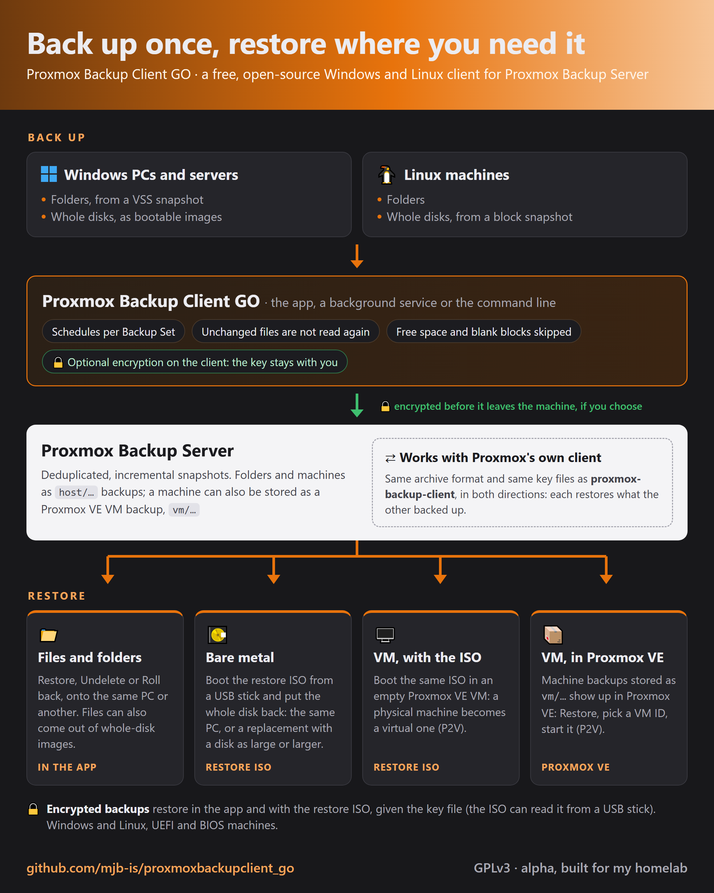
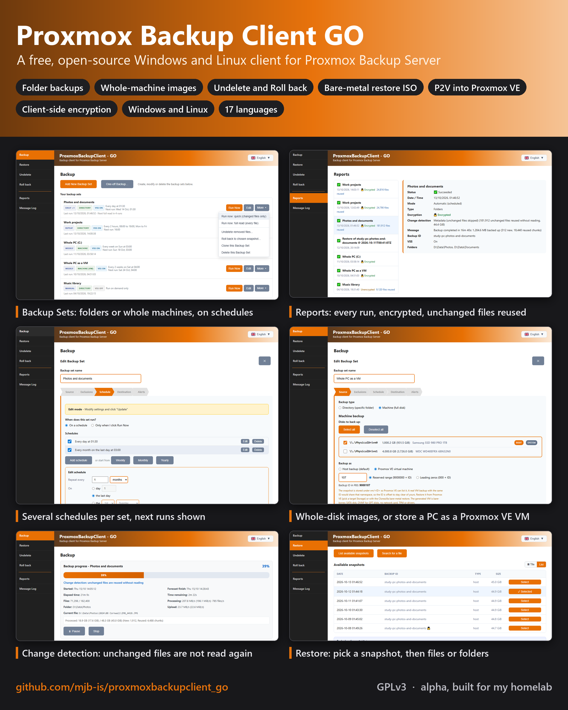

# Proxmox Backup Client: клиент для Windows и Linux к Proxmox Backup Server

[🇬🇧 English](README.md) · [🇫🇷 Français](README.fr.md) · [🇮🇹 Italiano](README.it.md) · [🇩🇪 Deutsch](README.de.md) · [🇪🇸 Español](README.es.md) · [🇷🇺 Русский](README.ru.md) · [🇨🇳 中文](README.zh.md) · [🇯🇵 日本語](README.ja.md) · [🇬🇷 Ελληνικά](README.el.md) · [🇷🇴 Română](README.ro.md) · [🇸🇪 Svenska](README.sv.md) · [🇸🇦 العربية](README.ar.md) · [🇮🇷 فارسی](README.fa.md)

[](LICENSE)
[](https://github.com/mjb-is/proxmoxbackupclient_go/releases)
[](docs/manual/README.md)
[](https://ko-fi.com/mickbeeby)

> **Основано на работе других.** Этот форк основан на оригинальном [proxmoxbackupclient_go](https://github.com/tizbac/proxmoxbackupclient_go) Тициано Бакокко (tizbac) и на графическом клиенте Nimbus Backup от RDEM Systems, который был влит в него и из которого выросла графическая оболочка этого приложения.
>
> ☕ Клиент бесплатный и останется бесплатным. Если он экономит вам время, вы можете [угостить меня кофе на Ko-fi](https://ko-fi.com/mickbeeby). Это полностью добровольно и не покупает ни поддержку, ни обещания новых функций.

**Proxmox Backup Client: клиент резервного копирования с открытым исходным кодом (GPL-3.0) для Proxmox Backup Server (PBS), для Windows и Linux.** Он сохраняет папки как файловые архивы, которые можно просматривать, а целые машины как загрузочные образы дисков, по расписанию или по запросу, и возвращает что угодно, от одного файла до целой машины, на тот же компьютер, на замену ему или в виртуальную машину Proxmox VE.

<p align="center">
  <a href="docs/screenshots/overview-how-it-works.png"></a>
  <a href="docs/screenshots/overview-screenshots.png"></a>
</p>

Я делаю его для своей домашней лаборатории, чтобы PBS стал единственной системой резервного копирования для смеси серверов, настольных компьютеров и ноутбуков с Windows и Linux, вместо Backup for Workgroups, зеркал rsync и образов Clonezilla/RescueZilla. Он появился в сентябре 2026 года как форк [tizbac/proxmoxbackupclient_go](https://github.com/tizbac/proxmoxbackupclient_go) и с тех пор далеко его перерос: более 350 коммитов, а 18 исправлений и функций отправлены обратно в исходный проект ([список ниже](#-вклад-в-исходный-проект)).

**Вы можете пользоваться им как есть.** Официально это **альфа-версия программы**: вы используете её на свой страх и риск, без каких-либо гарантий и обязательств. Я сам тестирую каждый выпуск, и программа постоянно работает на моих машинах, но прежде чем на неё полагаться, прочитайте раздел [Статус, сообщения об ошибках и пожелания](#-статус-сообщения-об-ошибках-и-пожелания).

В набор входят:

- **Proxmox Backup Client GUI**: программа для Windows и Linux. Backup Sets с несколькими расписаниями у каждого, копии папок и целых дисков с согласованными снимками (VSS в Windows, elastio-snap/dattobd в Linux), восстановление файлов из копий папок и машин, Undelete и Roll back, несколько серверов PBS, шифрование на стороне клиента и фоновая служба, чтобы расписания выполнялись, даже когда никто не вошёл в систему.
- **`proxmoxbackup-directory`**: копии папок (pxar) из командной строки, с дедупликацией и обнаружением изменений.
- **`proxmoxbackup-machine`**: копии целых дисков (fidx) работающих машин Windows и Linux из командной строки; после восстановления образ загружается.
- **`proxmoxbackup-nbd`**: подключает копию диска как устройство NBD (Linux).
- **ISO для восстановления на «голое железо»** на базе Clonezilla Live, с пошаговым восстановлением от включения питания до перезагрузки.

> Ключевые слова: proxmox backup client windows · клиент PBS · резервное копирование Windows с VSS · перенос физической машины в виртуальную (P2V) · восстановление на «голое железо» · интерфейс для Proxmox Backup Server.

## ⭐ Что умеет программа, с измеренными результатами

| | Результат |
|---|---|
| **Инкрементные копии папок** | Общая папка файлового сервера на 480,9 ГБ и 761 866 файлов: первый запуск 4 ч 17 мин, каждый следующий от 10 до 15 минут. Неизменённые файлы даже не открываются (обнаружение изменений Metadata, как в официальном клиенте). |
| **Быстрые копии машин** | Свободное место, файл подкачки и файл гибернации не читаются, а пустое место на диске не хешируется. Диск ноутбука на 1 ТБ, из них занято 373 ГБ: раньше от 1 ч 23 мин до 1 ч 44 мин, теперь 38 минут. Тестовый диск на 50 ГБ: было 3 мин 36 с, теперь 1 мин 15 с. |
| **Файлы из копий машин** | Образ диска просматривается как папка, и из него восстанавливаются отдельные файлы: NTFS, FAT, exFAT, ext2/3/4 и XFS. Диск C: ноутбука на 127 ГБ с 430 000 файлов открывается за время от 4 до 15 секунд; ничего не монтируется и не скачивается заранее. |
| **Физическая машина в виртуальную** | Сделайте копию ПК или сервера, затем запустите его как ВМ Proxmox VE: восстановив средствами самого Proxmox VE или с помощью ISO для восстановления. [Подробнее ниже](#-физические-машины-в-виртуальные-p2v). |
| **Восстановление на «голое железо»** | Загрузите ISO (флешка, CD или PXE), введите данные PBS, выберите копию: машина Windows на 32 ГБ вернулась к экрану входа через 8 минут после включения. |
| **Undelete** | После удаления 39 ГБ из общей папки на 761 000 файлов поиск за 7 дней нашёл ровно эти файлы примерно за минуту и вернул их на место. |
| **Roll back** | Возвращает папки набора в состояние на момент выбранной копии: сначала предварительный просмотр, а после можно сделать Undo. |
| **Расписания** | Несколько на каждый Backup Set, от раза в несколько минут до раза в год: «каждый день в 02:00» плюс «в последний день каждого месяца» или «во 2-й вторник», каждое описано простыми словами, с 3 ближайшими запусками. |
| **Точность восстановления** | Права NTFS, атрибуты, альтернативные потоки данных и расширенные атрибуты, время создания и время папок в Windows; режимы, владельцы, ACL, расширенные атрибуты и символические ссылки в Linux. Необязательный проход перечитывает восстановленное и сравнивает его с копией. |
| **Работает с инструментами самого Proxmox** | Копии, сделанные здесь, восстанавливаются байт в байт официальным `proxmox-backup-client`, и наоборот. [Подробнее](#-совместимость-с-официальным-клиентом-proxmox-в-обе-стороны). |

## 🧩 Что добавлено по сравнению с исходным проектом

Помимо [18 изменений, принятых в исходный проект](#-вклад-в-исходный-проект), этот клиент добавляет:

**Копии**
- Инкрементные копии папок с обнаружением изменений, как в официальном клиенте (режимы Data и Metadata, разделённые архивы pxar v2), с полным чтением каждые N запусков.
- Копии машин, которые пропускают свободное место, файл подкачки и файл гибернации (NTFS в Windows; ext2/3/4 и XFS в Linux), записывают нечитаемые секторы нулями и продолжают работу, а во время выполнения показывают число блоков, дисков, разделов и фрагментов.
- Pause, Resume и Stop для копий папок и машин, в том числе для копий, которые выполняет фоновая служба.
- Альтернативные потоки данных, расширенные атрибуты NTFS и время создания в копиях папок Windows.

**Расписания и Backup Sets**
- Несколько расписаний на Backup Set, от раза в несколько минут до раза в год (n-й день недели, последний день месяца), каждое описано простыми словами, с 3 ближайшими запусками.
- Фоновая служба не только в Windows, но и в Linux, и Restart as administrator в Linux.
- Быстрый или полный Run Now, значок VSS / Snapshot, предупреждение SHARED ID, имена наборов записываются в PBS как комментарии к снимкам, оповещения по e-mail, действия после копирования, экспорт и импорт настроек.

**Восстановление**
- Отдельные файлы из копий машин (NTFS, FAT, exFAT, ext2/3/4, XFS) без монтирования и скачивания образа.
- Undelete и Roll back для Backup Sets папок и машин, в GUI и из командной строки.
- Необязательная проверка после восстановления, время создания файлов Windows и дерево снимка, которое загружает папки по одной, поэтому даже очень большие копии открываются сразу.
- ISO для пошагового восстановления на «голое железо», которое восстанавливает и в пустую ВМ, и проверенные пути переноса физической машины в виртуальную ([P2V](#-физические-машины-в-виртуальные-p2v)).
- Совместимость байт в байт с официальным `proxmox-backup-client` в обе стороны, включая его снимки Data и Metadata (разделённый архив).

**Программа**
- Переработанный интерфейс: строка меню, боковое меню, Reports с полной историей копирования и восстановления, Message Log, пять цветовых тем и свой цвет, уведомления в трее и всплывающие уведомления.
- 18 языков интерфейса, каждый вычитан (в исходном проекте их 5).
- Папка настроек закрыта для всех, кроме администраторов (Windows) или владельца (Linux), а токен API службы обновляется при каждом запуске.
- Пакеты MSI, `.deb` и `.rpm` и руководства пользователя по GUI, командной строке и восстановлению на «голое железо».

## 🔄 Физические машины в виртуальные (P2V)

Копия физического ПК или сервера может стать виртуальной машиной Proxmox VE двумя способами:

**1. Восстановите её в Proxmox VE.** Задайте для Backup Set (или разовой копии) **Backup as: Proxmox VE virtual machine**. Копия сохраняется как `vm/<number>` с небольшой конфигурацией ВМ, поэтому Proxmox VE показывает её вместе с остальными копиями ВМ: откройте хранилище PBS в Proxmox VE, выберите копию, **Restore**, укажите ID ВМ и хранилище. ВМ получает один диск SATA и прошивку, подходящую для диска (OVMF для UEFI/GPT, SeaBIOS для BIOS/MBR); перед запуском добавьте сетевую карту, а если ВМ с UEFI не запускается, добавьте диск EFI (флажок Pre-Enroll keys снят).

**2. Восстановите её в пустую ВМ с помощью ISO для восстановления на «голое железо».** Создайте ВМ с той же прошивкой, что и у исходной машины (OVMF с диском EFI для UEFI/GPT, SeaBIOS для BIOS/MBR), с диском SATA не меньше исходного и сетевой картой Intel E1000, загрузите её с ISO и запустите восстановление. Так можно восстанавливать и копии `host`, и копии `vm`, а та же копия по-прежнему восстанавливается и на «голое железо».

Проверенные пути:

| Откуда | Куда | Способ | Результат |
|---|---|---|---|
| Ноутбук с Windows 10, UEFI/GPT | ВМ Proxmox VE | ISO для восстановления | Запустился до рабочего стола пользователя |
| Windows Server, UEFI/GPT | ВМ Proxmox VE | Восстановление в Proxmox VE | Запустился без изменений |
| Рабочая станция Xubuntu, UEFI/GPT | ВМ Proxmox VE | Восстановление в Proxmox VE и ISO для восстановления | Запустился до рабочего стола |
| Linux, BIOS/MBR | ВМ Proxmox VE | ISO для восстановления и восстановление в Proxmox VE | Запустился до приглашения входа |
| Linux Mint, зашифрованная копия | ВМ Proxmox VE | ISO для восстановления, ключ с флешки | Запустился |
| ПК с Linux | тот же ПК с новым диском | ISO для восстановления | Запустился |

При первом запуске Windows настраивает новое виртуальное оборудование («Подготовка устройств»). В [руководстве по восстановлению на «голое железо»](docs/manual/BMR.md#7-restoring-onto-different-hardware-p2v-and-replacement-machines) есть таблица прошивок, драйверы и пошаговые инструкции.

## 📖 Руководства пользователя

| Руководство | Содержание |
|---|---|
| **[Руководство по GUI](docs/manual/GUI.md)** | Установка, серверы PBS, Backup Sets и расписания, инкрементные копии, ход выполнения, восстановление, Undelete, Roll back, Reports, журналы, Preferences, фоновая служба, устранение неполадок |
| **[Руководство по командной строке](docs/manual/CLI.md)** | `proxmoxbackup-directory`, `proxmoxbackup-machine`, `proxmoxbackup-nbd`: все флаги, файлы конфигурации, коды выхода, планирование; Undelete и Roll back из командной строки |
| **[Руководство по восстановлению на «голое железо»](docs/manual/BMR.md)** | ISO для восстановления по шагам; копии `vm` в Proxmox VE; перенос физической машины в виртуальную; другое оборудование |
| [Сценарии восстановления](docs/RESTORE_GUIDE.md) | Какой способ восстановления выбрать и когда |
| [Оглавление руководств](docs/manual/README.md) | Обзор трёх руководств |

## 🆕 Новое в v0.10.0: что на самом деле уходит по сети, ключи, которые можно сохранить, руководства в программе

- **Что на самом деле отправляет копия.** Карточка хода выполнения, Reports и Message Log показывают **New/changed data**, **Data transferred** (сколько ушло по сети, в сжатом виде) и **Compression ratio**. Инкрементная копия диска на 128 ГБ с 365 МБ изменённых данных отправила 53 МБ.
- **Копия машины запускается заново, если пропало соединение с PBS**, через 2, 5, 10 и 15 минут, с обратным отсчётом на её карточке.
- **Сохраните копию ключа шифрования**: **Save a copy...**, **Print a paper key...** с QR-кодом и **Import...**, чтобы вернуть ключ из файла, с камеры, с фотографии или из введённого текста; перед сохранением ключ сверяется по отпечатку.
- **Руководства пользователя в программе**: страница **Help** (F1) с руководствами по GUI, командной строке и восстановлению на «голое железо», без подключения к сети и для той же версии.
- **Pause из трея** (Windows) для копий, которые выполняет программа или фоновая служба.
- **Forensic copy** для Backup Sets машин: читается и свободное место, так что удалённые файлы можно восстановить из образа.
- **Пароли в `config.json` шифруются в Windows** (DPAPI, для этого компьютера). Если после этого вернуться на 0.9.1 или более старую версию, их придётся ввести заново.
- **Настройка множества компьютеров через MSI**: `msiexec /i ... CONFIGFILE=<file>` объединяет экспортированный файл настроек, а Backup ID формируются из собственного имени каждого компьютера.
- **Каждая карточка Backup Set показывает, сколько времени прошло с последнего запуска**, а ссылки, сокеты и системные файлы, которые копия намеренно пропускает, больше не отображаются как предупреждение.
- **Исправления**: когда VSS был занят, копия могла зависнуть навсегда и удалить все теневые копии на компьютере; снимки VSS не освобождали дескрипторы; Run Now, переданный службе, выполнял действия после копирования (и мог выключить компьютер) сразу при старте запуска. ISO для восстановления на «голое железо» не показывает пароли в списке процессов, сохраняет machine ID восстановленной системы Linux и по завершении выключает машину, а не запускает восстановление с USB-флешки заново.

Предыдущие выпуски: **v0.9**: несколько расписаний на Backup Set, установщики для Windows и Linux, фоновая служба в Linux, файлы из копий машин со всеми распространёнными файловыми системами; **v0.8**: более быстрые копии машин (свободное место пропускается, сбойные секторы не прерывают копию), файлы из копий машин, Pause и Resume; **v0.7**: Undelete и Roll back; **v0.6**: инкрементные копии папок. Все изменения перечислены в [CHANGELOG](CHANGELOG.md).

## 🤝 Совместимость с официальным клиентом Proxmox, в обе стороны

Проверено с `proxmox-backup-client` 3.4.9 и PBS 4.2:

- **Снимки Legacy, Data и Metadata, сделанные этим клиентом, восстанавливаются официальным клиентом байт в байт**, как из GUI, так и из командной строки, сделанные в Windows или Linux, а файловый браузер PBS 4.2 их открывает. В Linux восстановленные файлы сохраняют и точный режим, и время изменения с точностью до наносекунды, и цели символических ссылок.
- **Снимки Legacy, Data и Metadata, сделанные официальным клиентом, восстанавливаются этим клиентом байт в байт**, полностью или выборочно.
- Тот же формат разделённого архива (pxar версии 2), те же режимы обнаружения изменений, тот же формат файла ключа шифрования (ключи из `proxmox-backup-client key create` работают здесь, а созданные здесь работают там), те же переменные окружения в стиле `PBS_REPOSITORY`.

Поэтому ваши копии никогда не привязаны к этому клиенту: инструменты самого Proxmox восстанавливают любой сделанный им снимок, а он восстанавливает любой снимок официального клиента. Единственное дополнение: один небольшой файл, который этот клиент добавляет в корень снимка папки, `.proxmox_backup_client_meta.json` (исходный путь); официальный клиент восстанавливает его как обычный файл.

> ⚠️ **Отказ от ответственности:** этот проект **никак не связан** с **Proxmox Server Solutions GmbH**. «Proxmox», логотип Proxmox и связанные названия принадлежат их владельцам; здесь они используются **только** для указания совместимости. О продуктах Proxmox см. [proxmox.com](https://www.proxmox.com/).

## 📦 Загрузка и установка

👉 **[Скачать последний выпуск](https://github.com/mjb-is/proxmoxbackupclient_go/releases)**

| У вас | Что использовать |
|---|---|
| Windows | **Установщик MSI** (`ProxmoxBackupClient-<version>-x64.msi`) устанавливает программу и фоновую службу в Program Files и добавляет пункт в меню «Пуск». Либо распакуйте `ProxmoxBackupClient-v<version>-windows-amd64.zip` (программа и `ProxmoxBackupClientSVC.exe`; держите их в одной папке) |
| Debian, Ubuntu, Mint | `sudo apt install ./proxmoxbackupclient_<version>_amd64.deb` |
| Fedora | `sudo dnf install ./proxmoxbackupclient-<version>-1.fc44.x86_64.rpm` |
| Другой Linux | Распакуйте `ProxmoxBackupClient-v<version>-linux-amd64.tar.gz` (нужна среда выполнения WebKitGTK 4.1) |
| Только командная строка | `ProxmoxBackupClient-CLI-v<version>-windows-amd64.zip` или `-linux-amd64.tar.gz` |
| Машина, которую нужно восстановить | `ProxmoxBackupClient-GO-BMR-Restore-v<version>.iso`, ISO для восстановления на «голое железо» |

MSI, `.deb` и `.rpm` появились в v0.9.0: в выпусках до v0.8.1 есть только файлы zip и tar.gz. Как собрать их самостоятельно, описано в [BUILD.md](BUILD.md).

Пакеты Linux устанавливают два пункта меню: **Proxmox Backup Client** запускает программу от вашего имени (копии ваших собственных файлов), а **Proxmox Backup Client (administrator)** запускает её от root, запрашивая ваш пароль через polkit, для копий машин и блочных снимков. Фоновая служба устанавливается, но не включается; см. [packaging/debian/README.md](packaging/debian/README.md).

> ⚠️ **Windows сообщает «обнаружен вирус» (например, `Trojan:Win32/Sabsik.FL.A!ml`) или показывает предупреждение SmartScreen?**
> Это **известное ложное срабатывание** для приложений Go/Wails: это *не* вирус. Суффикс `!ml` означает срабатывание модели машинного обучения, которая помечает *неподписанные и редкие* исполняемые файлы. Сверьте загруженный файл с `SHA256SUMS.txt` (ниже).

### 🔎 Проверка загрузки

В каждом выпуске есть `SHA256SUMS.txt`:

```powershell
Get-FileHash .\ProxmoxBackupClient-0.9.0-x64.msi -Algorithm SHA256   # compare with SHA256SUMS.txt
```

В Linux: `sha256sum -c SHA256SUMS.txt --ignore-missing`.

> ℹ️ **Подписи кода, аттестации с подписью CI и проверки VirusTotal пока нет.** Выпуски собираются и загружаются вручную, а не через конвейер CI, который мог бы выдать проверяемую аттестацию происхождения сборки. Если хотите помочь это настроить, см. [TODO.md](TODO.md).

## ✨ Возможности

### GUI
- **🌍 Многоязычность**: 18 языков интерфейса: французский, английский, итальянский, немецкий, польский, испанский, болгарский, чешский, греческий, венгерский, латышский, литовский, нидерландский, португальский, румынский, словацкий, турецкий и украинский
- Встроенная строка меню и боковое меню (Backup, Restore, Undelete, Roll back, Reports, Message Log, Preferences, About)
- **Backup Sets**: многократно используемые именованные задания с **несколькими расписаниями у каждого** (от раза в несколько минут до раза в год, или вручную), значок типа «папки или машина», значок VSS / Snapshot, «Run Now» (быстрый запуск или полное чтение для наборов Metadata) и предупреждение **SHARED ID**, когда два набора будут писать в одну группу копий
- **Разовые копии** папок или целых дисков
- Страница **Reports** с полной историей копирования и восстановления и ограниченный по размеру **Message Log** для диагностики
- Окно **Preferences** с пятью цветовыми темами (Amber, Blue, Green, Red, Dark) и возможностью задать свой цвет
- **Инкрементные копии папок** (обнаружение изменений, режим Metadata): неизменённые файлы используются повторно без чтения, как в официальном клиенте, с необязательным полным чтением каждые N запусков
- **Копии машин (целых дисков)** в Windows и Linux, которые пропускают свободное место и переживают сбойные секторы, с сохранением как `host` или как копия `vm` для Proxmox VE
- **Перенос физической машины в виртуальную**: копия машины восстанавливается в ВМ Proxmox VE, средствами Proxmox VE или через ISO для восстановления
- **Restore**: просмотр снимков, поиск файлов (шаблоны, регулярные выражения, полные пути) и выборочное восстановление, с ACL NTFS/POSIX, альтернативными потоками данных, временем папок, временем создания файлов Windows и необязательным проходом проверки
- **Файлы из копий машин**: просмотр и восстановление файлов с томов NTFS, FAT, exFAT, ext2/3/4 и XFS в образе диска
- **Undelete** и **Roll back**: найти файлы, которые ещё есть в копиях Backup Set, но уже нет на диске, и вернуть их; или вернуть папки набора в состояние на момент выбранной копии, сначала с предварительным просмотром, а потом с возможностью Undo. Для наборов папок и машин. См. [руководство по GUI](docs/manual/GUI.md#10-undelete)
- **Pause, Resume и Stop** для выполняющейся копии
- **Run as Service**: установка, запуск, остановка или удаление фоновой службы в Preferences > Advanced, чтобы расписания выполнялись, даже когда никто не вошёл в систему (Windows и Linux)
- Карточка хода выполнения в реальном времени: время начала и прогноз окончания, обработано файлов из общего числа, скорость обработки (данные и файлы в секунду) и фактическая скорость отправки, текущий файл и причина, по которой запуск читает все файлы
- VSS (теневые копии томов) в Windows, блочные снимки elastio-snap/dattobd в Linux
- Уведомления по e-mail и действия после копирования, клонирование Backup Set, экспорт и импорт настроек
- Несколько серверов PBS, с закреплением отпечатка сертификата (доверие при первом подключении), вход по токену API или по имени пользователя и паролю
- **Шифрование на стороне клиента**: файл ключа PBS для каждого сервера (AES-256-GCM, подписанный манифест), необязательная защита парольной фразой, см. [Шифрование на стороне клиента](#-шифрование-на-стороне-клиента)
- Защита изменения Backup Sets правами администратора, с Restart as administrator
- Отладочное журналирование для диагностики

### Утилиты командной строки
- `proxmoxbackup-directory`: копии папок (pxar) с дедупликацией и `-change-detection-mode legacy|data|metadata`
- `proxmoxbackup-machine`: копии целых дисков работающих машин Windows (VSS) и Linux (elastio-snap/dattobd) (fidx, инкрементно, свободное место пропускается, если не указан `-readfreespace`, `-type vm` для копии Proxmox VE)
- `proxmoxbackup-nbd`: сервер NBD для восстановления копий дисков (Linux)
- `ProxmoxBackupClientSVC` (Windows) и `proxmoxbackupclient` (пакеты Linux): `-list-sets`, `-undelete` и `-rollback` для Backup Sets, созданных в GUI

Первые три принимают `-keyfile` и `-keyfile-passphrase` для зашифрованных снимков. Полный справочник: [руководство по командной строке](docs/manual/CLI.md).

### 📸 Снимки экрана

<table>
<tr>
<td width="33%">

[](docs/screenshots/gui-backup-sets.png)
**Backup Sets**: именованные задания со значком расписания, которое выполнится следующим (DAILY, WEEKLY, MONTHLY, +N для остальных), и значком типа «папки или машина», Run Now на каждом

</td>
<td width="33%">

[](docs/screenshots/gui-backup-progress.png)
**Ход копирования в реальном времени**: скорость, оставшееся время и число новых и повторно использованных фрагментов по ходу работы

</td>
<td width="33%">

[](docs/screenshots/gui-restore.png)
**Restore**: выберите сервер PBS и Backup ID, получите список снимков или ищите по имени файла во всех снимках

</td>
</tr>
<tr>
<td width="33%">

[](docs/screenshots/gui-schedule-tab.png)
**Расписания**: несколько на набор, от раза в несколько минут до раза в год («каждый месяц в последний день», «во 2-й вторник»), с 3 ближайшими запусками

</td>
<td width="33%">

[](docs/screenshots/backup-set-as-vm.png)
**Копия как ВМ Proxmox VE**: выберите тип «виртуальная машина» и числовой ID; Backup ID в PBS показывается по мере ввода

</td>
<td width="33%">

[](docs/screenshots/backup-sets-vm-badge.png)
**Backup Sets как ВМ Proxmox VE**: набор, сохраняемый как копия `vm`, отмечен значком `MACHINE (VM)`

</td>
</tr>
<tr>
<td width="33%">

[](docs/screenshots/oneoff-as-vm.png)
**Разовые копии**: тот же параметр в форме разовой копии

</td>
<td width="33%">

[](docs/screenshots/gui-restore-progress.png)
**Выборочное восстановление**: отметьте отдельные файлы и папки в дереве снимка, восстановите на место или в другое место

</td>
<td width="33%">

[](docs/screenshots/gui-reports.png)
**Reports**: полная история запусков с панелью подробностей (длительность, фрагменты, скопированные папки)

</td>
</tr>
<tr>
<td width="33%">

[](docs/screenshots/gui-message-log.png)
**Message Log**: ограниченная по размеру лента диагностических сообщений с отметками времени по всем копиям и восстановлениям

</td>
<td width="33%">

[](docs/screenshots/gui-preferences-servers.png)
**Несколько PBS**: управление несколькими серверами PBS, проверка связи, выбор сервера по умолчанию

</td>
<td width="33%">

[](docs/screenshots/gui-preferences-edit-server.png)
**Добавление и изменение сервера**: URL, имя пользователя и пароль или токен API, хранилище данных и пространство имён

</td>
</tr>
<tr>
<td width="33%">

[](docs/screenshots/gui-theme-amber.png)
**Темы**: пять встроенных цветовых палитр и свой цвет, вся программа перекрашивается сразу (см. полосу ниже)

</td>
<td width="33%">

[](docs/screenshots/gui-preferences-advanced.png)
**Параметры копирования**: объяснены честно: параллельное извлечение при восстановлении экспериментальное и на нашем тестовом оборудовании оказалось *медленнее*

</td>
</tr>
</table>

**🎨 Цветовые темы**: при каждом выборе перекрашивается само окно Preferences, а не только образец цвета:

<table>
<tr>
<td width="16.6%">

[](docs/screenshots/gui-theme-amber.png)
Amber

</td>
<td width="16.6%">

[](docs/screenshots/gui-theme-blue.png)
Classic Blue

</td>
<td width="16.6%">

[](docs/screenshots/gui-theme-green.png)
Green

</td>
<td width="16.6%">

[](docs/screenshots/gui-theme-red.png)
Red

</td>
<td width="16.6%">

[](docs/screenshots/gui-theme-dark.png)
Dark

</td>
<td width="16.6%">

[](docs/screenshots/gui-theme-custom.png)
Custom

</td>
</tr>
</table>

**🌍 Многоязычность**: страница Reports на французском, итальянском и испанском (и ещё на 15 языках, включая английский, немецкий и польский):

<table>
<tr>
<td width="33%">

[](docs/screenshots/gui-lang-french.png)
Français

</td>
<td width="33%">

[](docs/screenshots/gui-lang-italian.png)
Italiano

</td>
<td width="33%">

[](docs/screenshots/gui-lang-spanish.png)
Español

</td>
</tr>
</table>

### Умные системные исключения (копии папок)
Копии папок сами пропускают следующее:

**Системные папки:** `System Volume Information` (хранилище VSS, может занимать более 100 ГБ) и `$RECYCLE.BIN`, где бы они ни находились; `Recovery` только в корне диска; `.pbs-rollback` (защитная папка Roll back).
**Системные файлы:** `pagefile.sys`, `hiberfil.sys`, `swapfile.sys` и `DumpStack.log.tmp`.

**Почему это важно:** диск может показывать 1,03 ТБ занятого места, когда настоящих файлов около 141 ГБ. Без исключений в копию попали бы снимки VSS (впустую потраченные место и время); с ними размер копии соответствует реальным данным.

**Рекомендация:** для копирования на уровне файлов используйте копию **папок** с этими исключениями; для восстановления на «голое железо» и P2V используйте копию **машины** в отдельном Backup Set (это образ целого диска; свободное место, файл подкачки и файл гибернации попадают в него как нули).

### Безопасность и качество
- Необязательное шифрование каждого фрагмента на стороне клиента, с подписанным манифестом
- Папка настроек доступна только администраторам в Windows и только владельцу в Linux
- Локальный API службы слушает только на 127.0.0.1 и требует токен, который обновляется при каждом запуске службы
- Проверка входных данных и очистка учётных данных
- Защита от обхода путей
- Повторные попытки с экспоненциальной задержкой
- Обработка ошибок и модульные тесты в каждом модуле, а также включаемые по желанию тесты на живом сервере и сквозные тесты с настоящим PBS

## 🔐 Шифрование на стороне клиента

Снимки можно шифровать до того, как они покинут машину, с помощью файла ключа Proxmox Backup Server (в формате, который записывает `proxmox-backup-client key create`, поэтому ключи взаимозаменяемы с официальным клиентом). Каждый фрагмент шифруется AES-256-GCM, а манифест подписывается. Сервер PBS никогда не видит ключ.

**GUI:** откройте **Preferences > Account Information**, измените сервер и перейдите на его вкладку **Encryption**. Импортируйте уже имеющийся ключ кнопкой **Import...** (копию файла ключа или бумажный ключ, считанный камерой, со скана или фото либо введённый вручную) или создайте новый кнопкой **Generate...**. На вкладке показан отпечаток ключа. В Reports видно, была ли зашифрована каждая копия. **Без файла ключа снимок восстановить нельзя: храните копию ключа в надёжном месте, вне этой машины.**

**Ключи, защищённые парольной фразой (scrypt или PBKDF2):** выберите, как программа будет открывать ключ:
- **Ask me**: парольная фраза запрашивается один раз за сеанс программы и хранится только в памяти. Копии по расписанию и при запуске никогда её не запрашивают: они сразу завершаются ошибкой с понятным сообщением, пока парольная фраза не введена в этом сеансе. Копия, выполняемая фоновой службой, с ключом Ask тоже сразу завершается ошибкой.
- **Remember on this computer**: парольная фраза хранится в конфигурации, как и токен PBS, поэтому любой, кто может прочитать `config.json`, может открыть ключ. Это вариант для заданий по расписанию без присмотра и для фоновой службы.

При восстановлении парольная фраза запрашивается, когда вы выбираете зашифрованный снимок.

**CLI:**
```shell
proxmoxbackup-directory.exe -baseurl ... -backupdir "C:\data" -datastore store -keyfile "C:\keys\pbs-key.json" -keyfile-passphrase "..."
```
`-keyfile-passphrase` нужен только для защищённого ключа и, если он не указан, запрашивается. `proxmoxbackup-machine` и `proxmoxbackup-nbd` принимают те же два флага; `proxmoxbackup-nbd` нужны они, чтобы подключить зашифрованный образ диска, и он проверяет первый фрагмент, прежде чем трогать устройство NBD, поэтому неверный ключ сразу даёт ошибку.

**Восстановление на «голое железо»:** ISO для восстановления запрашивает ключ (без ключа, файл ключа на флешке или путь, введённый вручную) и парольную фразу защищённого ключа. Ключ никогда не записывается в ISO. См. [PATCH-CLONEZILLA.md](PATCH-CLONEZILLA.md).

**Известные ограничения**
- Ключ, созданный в GUI, записывается с защищённым ACL (только текущий пользователь, SYSTEM и Administrators). Файлы ключей, которые вы храните в других местах, получают те права, которые даёт им их папка.
- `config.json` хранит токены PBS, пароли и запомненные парольные фразы открытым текстом. Начиная с v0.9.0 его папка доступна только администраторам (Windows) или только владельцу (Linux); до v0.8.2 включительно в Windows её могли читать локальные пользователи (Users), поэтому на общей машине ограничьте доступ сами.
- Для восстановления зашифрованного снимка нужен тот же файл ключа; если он потерян, восстановить ничего нельзя.
- Сценарий с ключом Ask и служба работают в разных процессах: для всего, что выполняется через службу, используйте Remember.

## Ускорение копий папок: обнаружение изменений

В режиме по умолчанию Legacy каждая копия папки читает все файлы, поэтому запуск длится столько же, сколько чтение всей папки, даже если ничего не изменилось. Backup Sets (и CLI) могут вместо этого использовать режимы обнаружения изменений официального `proxmox-backup-client`. Режим Metadata ежедневно используется на сервере с 480,9 ГБ и 761 866 файлами, где запуск с небольшим числом изменений занимает от 10 до 15 минут вместо более чем 4 часов.

| Режим | Что читается | Как хранится |
|---|---|---|
| **Legacy** (по умолчанию) | все файлы | один `<name>.pxar.didx` на папку, как раньше |
| **Data** | все файлы | разделённый архив: `<name>.mpxar.didx` (метаданные) + `<name>.ppxar.didx` (содержимое файлов) |
| **Metadata** | только новые и изменённые файлы | тот же разделённый архив; файлы, у которых размер и время изменения (с точностью до наносекунды), режим и владелец совпадают с предыдущей копией, берутся из неё без чтения |

В режиме **Metadata** первый запуск читает всё (сравнивать пока не с чем); следующие запуски читают только изменённое. Изменение файла, при котором сохраняются его размер и время изменения, не замечается, поэтому набор может также **читать все файлы каждые N запусков** (запуск Data): такой запуск ловит подобные изменения и убирает заполнение, которое повторное использование оставляет в архиве. Файл, который не удалось прочитать полностью (дополненный нулями после ошибки чтения), всегда перечитывается при следующем запуске. Повторное использование возможно только из предыдущей копии, зашифрованной так же и тем же ключом.

Поскольку неизменённые данные не читаются и не отправляются, трафик к удалённому или внешнему PBS сокращается почти до объёма реальных изменений.

**GUI:** измените Backup Set, вкладка **Destination**, **Change detection**. Это относится только к наборам папок: копии машин (целых дисков) являются образами дисков и не затрагиваются, поэтому восстановление на «голое железо» и в Proxmox VE работает точно так же, как раньше. Разовые копии используют Legacy. В счёт следующего полного чтения идут только успешно завершённые запуски; в списке Backup Sets показано «Next full read in N runs». Карточка хода выполнения сообщает, когда и почему запуск читает все файлы. **Reports** показывает режим каждого запуска и сколько неизменённых файлов было использовано повторно.

**Один Backup ID на набор.** Режим Metadata сравнивает с самым новым снимком в группе копий. Если два набора (или две машины) используют один и тот же Backup ID на одном сервере, каждый запуск сравнивает со снимком другого и читает всё. Редактор Backup Set предупреждает об этом.

**CLI:** `-change-detection-mode legacy|data|metadata` или `"change-detection-mode"` в конфигурации JSON. Флага CLI «каждые N запусков» нет: вместо этого время от времени запускайте копию по расписанию с `-change-detection-mode data`.

**Прежде чем переводить набор на Data или Metadata,** обновите до v0.6.0 или новее все машины, на которых вы восстанавливаете: сборки без поддержки разделённых архивов не могут их читать (они показывают папки без файлов). Официальный `proxmox-backup-client` восстанавливает их байт в байт (проверено с 3.4.9), и файловый браузер PBS 4.2 их открывает. Первая разделённая копия папки почти ничего не разделяет с её более старыми копиями Legacy, поэтому она занимает в хранилище данных примерно ещё одну полную копию этой папки, пока старые снимки не будут удалены.

## 🚀 Быстрый старт (GUI)

1. Установите программу: MSI в Windows, `.deb` или `.rpm` в Linux, либо распакуйте zip или tar.gz из [выпусков](https://github.com/mjb-is/proxmoxbackupclient_go/releases) (см. [Загрузка и установка](#-загрузка-и-установка))
2. Запустите её. В Windows используйте **Запуск от имени администратора** для VSS, копий машин и изменения Backup Sets. В Linux копии ваших собственных файлов работают от вашего имени; для копий машин и блочных снимков используйте **Proxmox Backup Client (administrator)** (или запускайте от root)
3. Добавьте свой сервер PBS в **Preferences > Account Information** и нажмите **Test**
4. Создайте Backup Set (или разовую копию) и выберите папки или диски для копирования
5. Запустите. Чтобы расписания выполнялись, даже когда никто не вошёл в систему, включите **Preferences > Advanced > Run as Service**

[Руководство по GUI](docs/manual/GUI.md) проводит через каждый шаг.

## Полная копия работающей машины

`proxmoxbackup-machine` (и копии машин в GUI) копирует целиком систему Windows 10/11 или Windows Server либо машину Linux без какого-либо простоя.

Синтаксис команды в основном такой же, как для копий папок, только вместо `-backupdir` указывается `-backupdev` (повторите его для нескольких дисков).
Например, вызов может выглядеть так:

`proxmoxbackup-machine.exe -authid yourapikey -backupdev \\.\PhysicalDrive0 -baseurl https://yourpbs:8007 -certfingerprint xx:xx:xx... -datastore zfs -secret L4m3r -backup-id testfull1`

Эта команда обращается к диску 0, находит все смонтированные разделы, делает их снимок VSS, а затем создаёт загрузочный образ всего диска в формате fidx. Свободное место, файл подкачки и файл гибернации попадают в образ как нули без чтения (в Linux также свободное место ext2/3/4 и XFS); `-readfreespace` вместо этого читает всё, для криминалистической копии. Сектор, который не удаётся прочитать, попадает в образ как нули, а в выводе запуска указывается, где именно. Добавьте `-type vm`, чтобы сохранить копию как копию ВМ Proxmox VE ([P2V](#-физические-машины-в-виртуальные-p2v)).

Следующая копия будет инкрементной; хеширование распараллелено, так что скорость 1 ГБ/с достигается без труда.

### Требования для копий машин Linux (аналог VSS)

Копия машины Windows использует VSS (отсюда «Запуск от имени администратора» выше); в Linux VSS нет, поэтому
этот проект использует для той же задачи модуль ядра `elastio-snap` (форк `dattobd`):
согласованный снимок работающего блочного устройства на момент времени, пока на него продолжается запись. Исходный
репозиторий `elastio/elastio-snap` переведён в архив; поддерживаемая версия находится в
[`Axcient/elastio-snap`](https://github.com/Axcient/elastio-snap), её и нужно устанавливать. Сам `dattobd`
тоже поддерживается, если он уже загружен.

Оба следующих условия обязательны, независимо друг от друга, иначе копия машины Linux откажется запускаться:

1. **Модуль ядра должен быть установлен и загружен.** Описанная в документации `elastio-snap` установка из пакетного
   репозитория (см. [его INSTALL.md](https://github.com/Axcient/elastio-snap/blob/develop/INSTALL.md)) сейчас
   указывает на перемещённый или нерабочий URL как минимум для Ubuntu 22.04 (подтверждено 2026-09-24: пакет репозитория
   после перенаправления отдаёт 404). Сборка из исходников, напротив, работает надёжно:
   ```bash
   sudo apt-get install linux-headers-$(uname -r) build-essential   # Debian/Ubuntu
   git clone --depth 1 https://github.com/Axcient/elastio-snap.git
   cd elastio-snap
   sudo make
   sudo make install
   sudo depmod -a     # required - `make install` only copies the .ko, it never
                       # runs depmod, so a bare `modprobe elastio-snap` right
                       # after a fresh install fails with "not found in
                       # directory" even though the file is right there
                       # (confirmed live 2026-09-24)
   sudo modprobe elastio-snap
   lsmod | grep elastio-snap   # confirms it loaded
   ```
   Так модуль собирается и загружается только для текущей загрузки системы; если нужно, чтобы он загружался автоматически
   при каждой загрузке, см. документацию вашего дистрибутива (например, запись в `/etc/modules-load.d/`).

2. **Сам процесс копирования должен выполняться от root (EUID 0).** Даже при загруженном модуле `CreateVSSSnapshot`
   (путь создания снимков в Linux, несмотря на название в духе Windows) явно отказывается работать от имени обычного пользователя:
   согласованному снимку целого диска нужен интерфейс управления модулем, доступный только root, поэтому это жёсткое
   требование, и членство в группе `disk` или что-то подобное его не заменяет. Для копии машины используйте
   пункт меню **Proxmox Backup Client (administrator)**, фоновую службу или запускайте GUI либо
   `proxmoxbackup-machine` через `sudo` (или от root); для обычной копии файлов или папок такого требования нет.

Если копия машины завершается ошибкой `backup device /dev/sdX: open /dev/sdX: permission denied`, обычно
достаточно добавить пользователя в группу `disk` для базового доступа на чтение (`sudo usermod -aG disk $USER`, затем выйти
и войти снова), но одного этого НЕ хватит для настоящего снимка; сразу после этого вы всё равно упрётесь в
требование root, описанное выше.

### Восстановление файлов из копии диска

Страница Restore в GUI открывает копию машины так же, как копию папок: каждый том в образе (NTFS, FAT, exFAT, ext2/3/4 или XFS) является папкой, которую можно просматривать и из которой можно восстанавливать. Ничего не монтируется.

В Linux копию диска можно также подключить как блочное устройство с помощью утилиты nbd.

Чтобы использовать nbd, сначала выполните `modprobe nbd max_part=0`.

По неизвестным причинам при `max_part != 0` возникает бесконечный цикл опроса разделов.

Утилита NBD подключает любую копию фиксированного диска, независимо от того, копия это ВМ или хоста (поэтому она работает и с копиями PVE).

Используйте командную строку примерно такого вида:
`./proxmoxbackup-nbd -authid 'apikey' -baseurl https://yourpbs:8007 -secret 'yoursecret' -certfingerprint 'aa:...:xx' -datastore test -namespace test1 -path "vm/107/2025-08-02T23:13:01Z/drive-virtio0.img.fidx"`

Если не указать `-path`, появится текстовый интерфейс для выбора файла fidx.

> Не используйте это на машине, где работает что-то важное: повреждённая файловая система может обрушить ОС, именно поэтому Proxmox VE использует для этого экземпляр QEMU.

Прежде чем останавливать `proxmoxbackup-nbd`, размонтируйте всё на диске nbd, иначе раздел, скорее всего, останется занятым и его будет невозможно размонтировать.

Если вы получили ошибку `Device or resource busy`, придётся принудительно отключиться командой `nbd-client -d /dev/nbd0` или просто перезагрузиться.

### Восстановление на физическую машину или ВМ

В ISO для восстановления на «голое железо» есть полностью автоматический пункт меню загрузки **«PBS Bare Metal Restore»**: см. [ISO для восстановления на голое железо](#-iso-для-восстановления-на-голое-железо) ниже. Это первый пункт, выбираемый по умолчанию по истечении времени ожидания, и он пропускает собственные вопросы Clonezilla о языке и клавиатуре: введите данные подключения к PBS, выберите снимок, подтвердите найденный целевой диск, а настройку сети, подключение NBD, само восстановление и автоматическую перезагрузку он выполнит без дальнейшего участия. Тот же ISO восстанавливает и в пустую виртуальную машину для [P2V](#-физические-машины-в-виртуальные-p2v).

Старый полуручной путь тоже по-прежнему есть на том же ISO, отдельным пунктом в обычном меню выбора режима Clonezilla («pbs-nbd»): он проводит вас через ввод данных подключения к PBS и подключает выбранный снимок к `/dev/nbd0` в фоне, а затем оставляет вам само восстановление, которое вы выполняете вручную через стандартный мастер восстановления дисков Clonezilla.

## Использование: копирование папок

Полный справочник с примерами для Windows и Linux, кодами выхода и планированием находится в **[руководстве по командной строке](docs/manual/CLI.md)**. Типичная команда:

```shell
proxmoxbackup-directory.exe -baseurl "https://yourpbshost:8007" -certfingerprint pbsfingerprint -authid "user@realm!apiid" -secret "apisecret" -backupdir "C:\path\to\backup" -datastore "datastorename"
```

```
proxmoxbackup-directory
  -baseurl string            PBS URL, example: https://192.168.1.10:8007
  -certfingerprint string    Certificate fingerprint (asked for interactively when omitted)
  -authid string             API token ID (user@realm!token)
  -secret string             API token secret
  -pbsusername string        PBS user for ticket login (with -pbspassword; overrides -authid/-secret)
  -pbspassword string        Password for -pbsusername (asked for when omitted)
  -datastore string          Datastore name
  -namespace string          Namespace (optional)
  -backup-id string          Backup ID (default: the hostname)
  -backupdir string          Source directory; repeat for several (each becomes group <id>_<path>)
  -change-detection-mode     legacy (default), data or metadata
  -novss                     Do not snapshot the source (VSS on Windows, elastio-snap/dattobd on Linux)
  -keyfile string            PBS encryption key file
  -keyfile-passphrase string Passphrase for a protected key (asked for when omitted)
  -no-mtime                  Record 1970-01-01 as every file and folder time (advanced; see the CLI manual)
  -backupstream string       Back up standard input as <name>.didx instead of a directory
  -pxarout string            Also write the archive to a local file (debugging)
  -mail-host, -mail-port, -mail-username, -mail-password, -mail-insecure,
  -mail-from, -mail-to, -mail-subject-template, -mail-body-template
                             Email report (optional)
  -config string             JSON config file; flags given on the command line override it
```

Также читаются переменные окружения официального клиента `PBS_REPOSITORY`, `PBS_SERVER`, `PBS_PORT`, `PBS_DATASTORE`, `PBS_AUTH_ID`, `PBS_PASSWORD` и `PBS_FINGERPRINT`.

Для конфигурации JSON приложен пример JSON; заполните только нужные поля.

Замечание о шаблонах писем:
для темы и текста писем используется [механизм шаблонов Go](https://pkg.go.dev/text/template), синтаксис описан в его документации.
В шаблонах доступны следующие переменные:

- `.NewChunks`: число созданных новых фрагментов
- `.ReusedChunks`: число повторно использованных фрагментов
- `.Datastore`: имя хранилища данных
- `.Error`: ошибка, если была (`.ErrorStr` даёт её в виде текста, пустого, если ошибки нет)
- `.ReadErrors`: файлы или папки, которые не удалось прочитать; `.ReadErrorCount`: их число
- `.Hostname`: имя хоста машины
- `.StartTime`: время начала копирования
- `.EndTime`: время окончания копирования
- `.Duration`: длительность копирования
- `.FromattedDuration`: отформатированная длительность копирования (в коде имя пишется именно так)
- `.Success`: true, если копирование завершилось без ошибок и без нечитаемых файлов
- `.Partial`: true, если снимок сохранён, но некоторые файлы не удалось прочитать
- `.Status`: `Success`, `Partial` или `Failed`

## Копирование потока

Можно копировать поток вместо pxar, а это открывает бесконечные возможности. Например, можно вызвать:

```
mysqldump yourdatabase | ./proxmoxbackup-directory -backupstream yourdatabase.sql [other options]
```

Так buzhash обеспечивает дедупликацию, даже если используется, например, tar или сам дамп SQL.

## Известные проблемы

Включённая защита от вредоносных программ Windows Defender замедляет копирование, до 25% от достижимой скорости.

В Windows утилиты командной строки берут блокировку процесса: вторая копия, запущенная во время работы первой, выводит «Another backup job is running» и завершается. В Linux такой блокировки нет, поэтому не планируйте два запуска CLI на одно и то же время.

## 📋 Требования

- Windows 10/11 или Windows Server (64-разрядные), с правами администратора для VSS и копий машин
- или Linux (пакеты предназначены для Debian, Ubuntu, Mint и Fedora), со средой выполнения WebKitGTK для GUI, а для согласованных копий машин с правами root и модулем ядра elastio-snap или dattobd
- Сетевой доступ к Proxmox Backup Server
- Для P2V: Proxmox VE с хранилищем данных PBS, добавленным как хранилище, или любой гипервизор, который может загрузить ISO для восстановления

## 🔨 Сборка из исходников

В **[BUILD.md](BUILD.md)** есть полные инструкции: GUI и фоновая служба, утилиты командной строки, MSI и пакеты Linux. Вкратце, с Go 1.25 или новее и Wails CLI v2.13:

```bash
cd gui
wails build                                    # the app, in gui/build/bin
go build -tags service -o build/bin/ProxmoxBackupClientSVC.exe   # the background service
```

```bash
packaging/debian/build-deb.sh     # .deb
packaging/fedora/build-rpm.sh     # .rpm (in Docker)
```

```powershell
installer\wix\build-msi.ps1       # MSI (WiX 3), after building the app and the service
```

Собранный фронтенд (`gui/frontend/dist`) хранится в репозитории, поэтому Node.js нужен, только чтобы изменить фронтенд (`npm install` и `npm run build` в `gui/frontend`, или `wails dev` для горячей перезагрузки). Тесты: `make test`.

## 🔧 Расширенное использование и руководства

### Multi-PBS (несколько серверов PBS)

Настройте несколько серверов PBS и выбирайте целевой сервер для каждого Backup Set или разовой копии (например, `C:\Users` ежедневно на быстрый PBS на SSD, `D:\` еженедельно на PBS для больших данных, плюс сервер аварийного восстановления).

- **[Руководство пользователя](MULTI_PBS_USER_GUIDE.md)**: добавление и проверка серверов, сервер по умолчанию, выбор сервера для каждой копии, вопросы и ответы, устранение неполадок.
- **[Руководство по реализации](MULTI_PBS_GUIDE.md)**: модель данных, автоматический перенос конфигурации с одним PBS, методы бэкенда.

Старая конфигурация с одним PBS при первой загрузке автоматически переносится в сервер `default`.

### 💿 ISO для восстановления на голое железо

ISO для восстановления представляет собой стандартный ISO Clonezilla Live, дополненный двоичными файлами `pbsnbd` / `machinebackup` и двумя пунктами меню. Он загружается с CD, с флешки (записанной через `dd` или с флешки Ventoy), по PXE, на машинах с UEFI или BIOS:

- **`ocs-pbs-bare-metal-restore`**: первый пункт меню загрузки, выбираемый по умолчанию по истечении времени ожидания, **«Proxmox Backup Client Go - PBS Bare Metal Restore»**. Он пропускает вопросы Clonezilla о языке и клавиатуре и её общий мастер и ведёт прямо от учётных данных PBS к завершённому восстановлению с автоматической перезагрузкой: сначала DHCP (запрос статического IP только если он не сработал), синхронизация NTP, ключ шифрования с флешки, если копия зашифрована, и поиск целевого диска, который никогда не предлагает флешку, с которой выполнена загрузка. При успехе он показывает сообщение о завершении и перезагружается. Он восстанавливает и копии Windows, и копии Linux (восстановление идёт на уровне блоков), на «голое железо» или в пустую ВМ.
- **`ocs-pbs-nbd`**: пункт **«pbs-nbd»** в собственном меню выбора режима Clonezilla. Запрашивает данные подключения к PBS и снимок для восстановления, подключает его к `/dev/nbd0` в фоне, а затем передаёт управление обычному мастеру восстановления дисков Clonezilla, которым вы управляете вручную.

На стороне восстановления также исправлены: взаимоблокировка `zstd.NewReader` в пути получения фрагментов PBS, из-за которой зависало восстановление целых машин (передано в исходный проект как [PR #85](https://github.com/tizbac/proxmoxbackupclient_go/pull/85)), ошибка «первый проход восстановления падает с 'no partition', повторный запуск проходит», вызванная гонкой собственной функции Clonezilla `is_disk_without_part_and_fs()` с udev, и машины с BIOS/MBR, которые не запускались после восстановления (теперь восстанавливаются и данные между MBR и первым разделом).

```bash
./patch-clonezilla.sh \
  -o clonezilla-live-patched.iso \
  clonezilla-live-3.3.3-37-amd64.iso \
  ./build/pbsnbd ./build/machinebackup \
  ./clonezilla-patch/ocs-pbs-nbd ./clonezilla-patch/ocs-pbs-bare-metal-restore
```

Все подробности (почему полная пересборка ISO вместо замены на месте, требования, ход меню, проверка) в **[PATCH-CLONEZILLA.md](PATCH-CLONEZILLA.md)**; как им пользоваться, описано в **[руководстве по восстановлению на «голое железо»](docs/manual/BMR.md)**.

### Сборка GUI для Windows

**Нативно в Windows**: набор инструментов (Go, MinGW, Wails) и команды для программы, службы и MSI описаны в **[BUILD.md](BUILD.md)**.

**Docker (при сборке в Linux).** `./build_gui_windows_docker.sh` собирает программу для Windows как `ProxmoxBackupClientGO.exe`, с полноценной поддержкой WebView2, в одноразовом контейнере `golang` (устанавливает mingw и Wails, собирает фронтенд, выполняет `wails build`). Фоновую службу и MSI он не собирает.

### Состояние функций, журнал изменений и внутренняя документация

- **[FEATURES_STATUS.md](FEATURES_STATUS.md)**: что сделано, сделано частично или не сделано, и с какой версии.
- **[CHANGELOG.md](CHANGELOG.md)**: история изменений по версиям и [Unreleased] для того, что уже есть в master.
- **[TODO.md](TODO.md)**: открытые планы и идеи.
- **[RELEASE_NOTES.md](RELEASE_NOTES.md)**: что входит в каждый выпуск.
- **[MSI_UNINSTALL_TEST.md](MSI_UNINSTALL_TEST.md)**: окно удаления MSI (сохранить или удалить конфигурацию) и план его тестирования.
- **[AGENTS.md](AGENTS.md)**: структура репозитория и соглашения, для участников и ИИ-агентов, пишущих код.

## 🔁 Вклад в исходный проект

Исправления и функции общего назначения предлагаются в [tizbac/proxmoxbackupclient_go](https://github.com/tizbac/proxmoxbackupclient_go) как pull request. Принято восемнадцать:

  - [PR #85](https://github.com/tizbac/proxmoxbackupclient_go/pull/85): Fix zstd decoder goroutine deadlock in `GetChunkData` (hung full-machine restores)
  - [PR #86](https://github.com/tizbac/proxmoxbackupclient_go/pull/86): Fully automated PBS Bare Metal Restore boot entry for the Clonezilla ISO
  - [PR #87](https://github.com/tizbac/proxmoxbackupclient_go/pull/87): Linux snapshots: drive elastio-snap/dattobd through ioctl instead of `elioctl`/`dbdctl`
  - [PR #88](https://github.com/tizbac/proxmoxbackupclient_go/pull/88): Restore: re-apply captured NTFS ACLs (Windows) and POSIX ACLs and xattrs (Linux)
  - [PR #90](https://github.com/tizbac/proxmoxbackupclient_go/pull/90): `machinebackuplib`: make `vm` backups restorable and bootable on Proxmox VE
  - [PR #91](https://github.com/tizbac/proxmoxbackupclient_go/pull/91): GUI: back machines up as `host`, not `vm`, by default
  - [PR #92](https://github.com/tizbac/proxmoxbackupclient_go/pull/92): `patch-clonezilla`: skip patches whose change is already in the base ISO
  - [PR #93](https://github.com/tizbac/proxmoxbackupclient_go/pull/93): `patch-clonezilla`: add the PBS bare-metal restore entry to `isolinux.cfg`
  - [PR #94](https://github.com/tizbac/proxmoxbackupclient_go/pull/94): Restore the data between the MBR and the first partition in the BMR flow (BIOS/MBR machines boot after restore)
  - [PR #95](https://github.com/tizbac/proxmoxbackupclient_go/pull/95): Fix reading passphrase-protected key files made by `proxmox-backup-client`
  - [PR #96](https://github.com/tizbac/proxmoxbackupclient_go/pull/96): `directorybackup`: back up several directories in one run
  - [PR #97](https://github.com/tizbac/proxmoxbackupclient_go/pull/97): Docs: point elastio-snap at the maintained Axcient fork
  - [PR #98](https://github.com/tizbac/proxmoxbackupclient_go/pull/98): `pbscommon`: skip the key file permission check on Windows
  - [PR #99](https://github.com/tizbac/proxmoxbackupclient_go/pull/99): Restore encrypted backups from the Clonezilla BMR ISO
  - [PR #102](https://github.com/tizbac/proxmoxbackupclient_go/pull/102): `snapshot`: delete our VSS shadow copies after every backup, through the VSS API
  - [PR #103](https://github.com/tizbac/proxmoxbackupclient_go/pull/103): `machinebackup`: skip hashing blank (all-zero) chunks
  - [PR #104](https://github.com/tizbac/proxmoxbackupclient_go/pull/104): CLIs: report errors on stderr, never in a message box
  - [PR #105](https://github.com/tizbac/proxmoxbackupclient_go/pull/105): Restore: put back every file time, also 1970 and earlier, and folder times

## 🧪 Статус, сообщения об ошибках и пожелания

**Это альфа-версия программы, она предоставляется «как есть», без каких-либо гарантий и обязательств, и вы используете её полностью на свой страх и риск.** Я не несу никакой ответственности за потерянные или повреждённые данные, включая исходные файлы.

Программа сделана для моей домашней лаборатории. Каждый выпуск я сам тестирую перед публикацией, и она постоянно там работает: копии папок и машин по расписанию на машинах с Windows и Linux, а по ходу дела проверены восстановление, Undelete, Roll back, восстановление на «голое железо» и восстановление P2V. Ни одна копия не проверена, пока вы из неё не восстановились, поэтому проверьте собственные восстановления, включая восстановление на «голое железо», прежде чем полагаться на программу.

- **Сообщения об ошибках приветствуются**: откройте [issue](https://github.com/mjb-is/proxmoxbackupclient_go/issues) и опишите, что вы сделали, что произошло, и приложите журнал (Message Log или файлы из папки настроек).
- **Пожелания новых функций**: я добавляю функции, которые помогают мне самому, поэтому не принимаю пожелания для других. Пожалуйста, отправляйте их в исходный проект, [tizbac/proxmoxbackupclient_go](https://github.com/tizbac/proxmoxbackupclient_go/issues). Pull request, которые исправляют ошибки или явно пригодятся и мне, приветствуются.

Самая полезная помощь: отчёты об ошибках и исправления. Если хотите поблагодарить иначе, вы можете [угостить меня кофе на Ko-fi](https://ko-fi.com/mickbeeby).

## 🙏 Благодарности и история

Исходный клиент командной строки написал Tiziano Bacocco (tizbac) начиная с 2023 года. Позже в него был влит графический клиент RDEM Systems, а вместе с ним первый GUI, поддержка нескольких PBS и служба Windows. Этот форк начат в сентябре 2026 года, чтобы закрыть пробелы, которые мешали PBS стать моей единственной системой резервного копирования; его выпуски начинаются с v0.3.0, а исправления общего назначения уходят обратно в исходный проект.

- Исходный клиент, [proxmoxbackupclient_go](https://github.com/tizbac/proxmoxbackupclient_go), от Tiziano Bacocco (tizbac) и его участников.
- Графический клиент Nimbus Backup от RDEM Systems, с которого началась графическая оболочка этого приложения.
- Подход и ощущение от Backup for Workgroups (BFW), которым следуют Backup Sets, Undelete и Roll back.
- [Clonezilla Live](https://clonezilla.org/), на основе которого построен ISO для восстановления на «голое железо».

## 📄 Лицензия

GPLv3: см. файл [LICENSE](LICENSE).

---

**Изменения после форка © 2026 mjb-is, на основе работы Tiziano Bacocco (tizbac), участников Proxmox Backup Client GO и RDEM Systems (© 2024-2026).**

☕ Если этот клиент вам полезен, вы можете [угостить меня кофе на Ko-fi](https://ko-fi.com/mickbeeby). Спасибо.
